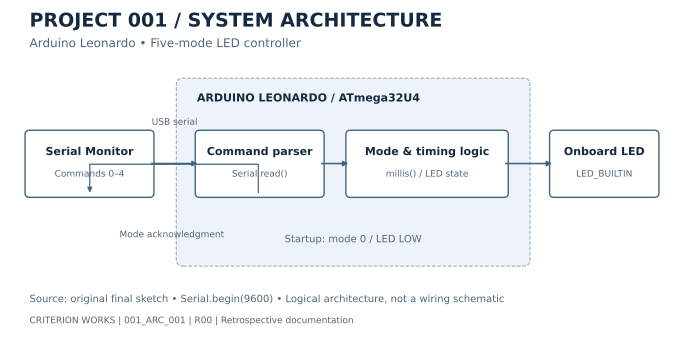
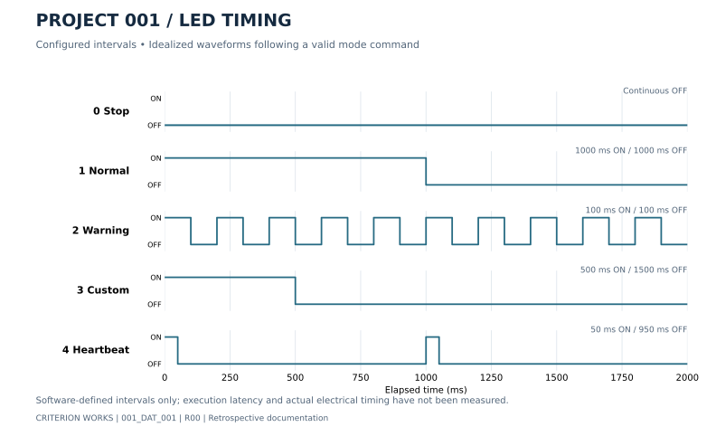

# Project 001 — LED Control System

**Criterion Works | Engineering Portfolio**

| Project Information | Details |
|---|---|
| Project ID | 001 |
| Platform | Arduino Leonardo |
| Discipline | Electronics and Embedded Systems |
| Development Status | Completed |
| Functional Testing | Developer-reported pass |
| Source Code Review | Completed |
| Documentation Revision | R02 |

## 1. Project Overview

This project implements a programmable LED control system using the Arduino Leonardo microcontroller.

Development progressed from basic digital output control to a multi-mode, serial-controlled application utilizing non-blocking timing.

The final application allows the operator to select between five operating modes through the Arduino Serial Monitor.

## 2. Engineering Objectives

- Implement digital output control.
- Implement serial command processing.
- Develop multiple operating modes.
- Transition from blocking to non-blocking timing.
- Implement a heartbeat status indicator.
- Verify functional operation across all five modes.

## 3. Hardware and Software

| Component | Specification | Quantity |
|---|---|---:|
| Microcontroller | Arduino Leonardo | 1 |
| Indicator | Integrated onboard LED | 1 |
| Communication and Power | USB cable | 1 |
| Development Environment | Arduino IDE | N/A |
| Programming Language | Arduino C/C++ | N/A |

The application controls the onboard LED using the LED_BUILTIN pin definition.

## 4. System Architecture

*Figure 1 — System architecture derived from the final controller implementation.*

The system consists of four primary functional elements:

1. Serial Monitor operator interface.
2. Serial command processing.
3. Operating mode and non-blocking timing logic.
4. Digital LED output.

The microcontroller processes incoming serial commands and controls the LED according to the selected operating mode.

## 5. Operating Modes

*Figure 2 — Nominal LED timing derived from configured software intervals. Waveforms represent intended behavior, not instrument measurements.*

| Command | Operating Mode | ON Duration | OFF Duration |
|---|---|---:|---:|
| 0 | Stop | OFF | Continuous |
| 1 | Normal | 1000 ms | 1000 ms |
| 2 | Warning | 100 ms | 100 ms |
| 3 | Custom | 500 ms | 1500 ms |
| 4 | Heartbeat | 50 ms | 950 ms |

Serial initialization: 9600 baud.

The timing values listed above are configured software intervals, not instrument-measured results.

The controller initializes in Stop mode with the LED turned off.

## 6. Source Code

### Final Application

[Project001_Final_5Mode_Controller.ino](src/Project001_Final_5Mode_Controller/Project001_Final_5Mode_Controller.ino)

### Development History

| Stage | Implementation | Source |
|---|---|---|
| Challenge 4 | Four operating modes using blocking delays | [View code](development/Project001_Challenge4/Project001_Challenge4.ino) |
| Challenge 5 | Non-blocking LED timing using millis() | [View code](development/Project001_Challenge5/Project001_Challenge5.ino) |
| Challenge 6 | Integrated five-mode non-blocking controller | [View code](development/Project001_Challenge6/Project001_Challenge6.ino) |
| Final Application | Final retained five-mode controller | [View code](src/Project001_Final_5Mode_Controller/Project001_Final_5Mode_Controller.ino) |

All four retained source files are preserved without modification.

Challenge 6 and the final application contain identical implementations.

## 7. Engineering Design Decisions

### Blocking versus Non-Blocking Timing

Challenge 4 implements LED timing using delay().

Challenge 5 introduces millis()-based timing with a 250 ms LED state transition interval.

Challenge 6 integrates elapsed-time calculations with serial-controlled operating modes and independent ON/OFF timing values.

The final implementation eliminates delay() calls, allowing the main program loop to continue processing serial commands while LED timing is active.

### Operating Mode Transitions

Upon receiving a valid command, the controller resets its timing reference and updates the LED state.

Stop mode immediately sets the LED output LOW when processed. All other valid operating modes initiate with the LED output HIGH.

### Heartbeat Indication

A repeating 50 ms ON and 950 ms OFF interval provides a basic visual indication of controller activity.

## 8. Operating Instructions

1. Connect the Arduino Leonardo through USB.
2. Open the final application in Arduino IDE.
3. Select the Arduino Leonardo board and appropriate port.
4. Upload the sketch.
5. Open the Serial Monitor.
6. Enter a command from 0 through 4.
7. Observe the corresponding LED behavior.

## 9. Functional Testing

| Test ID | Function | Reported Result |
|---|---|---|
| T001 | Basic LED output | Pass |
| T002 | Stop mode | Pass |
| T003 | Normal mode | Pass |
| T004 | Warning mode | Pass |
| T005 | Custom mode | Pass |
| T006 | Heartbeat mode | Pass |
| T007 | Serial mode selection | Pass |
| T008 | Non-blocking operation | Pass |

Functional results are based on observations reported during original hands-on development.

A subsequent static source code review confirmed the implemented operating modes, configured timing values, startup state, and non-blocking timing structure.

Independent compilation, hardware retesting, and instrument-based timing validation have not been performed during documentation review.

## 10. Known Limitations

- The Challenge 4 startup message omits command 3.
- The final application startup message omits command 4.
- Both omitted commands are implemented in their respective applications.
- Invalid serial commands are ignored without an error message.
- LED timing accuracy has not been measured using external instrumentation.

The original source files remain unchanged to preserve development history.

## 11. Skills Practiced

- Arduino C/C++ programming
- Digital output control
- Conditional logic
- Boolean state management
- Serial communication
- Operating mode management
- Non-blocking timing
- Incremental software development
- Functional testing and troubleshooting

## 12. Lessons Learned

- Blocking delays can limit controller responsiveness.
- Non-blocking timing allows additional program logic to execute during timed operations.
- Serial communication provides a practical interface for embedded system testing.
- Incremental development simplifies functional testing and troubleshooting.
- Visual status indicators provide useful operational feedback.

## 13. Future Improvements

- Physical push-button control.
- Additional digital outputs.
- Expanded diagnostic feedback.
- Invalid command handling.
- Complete startup command instructions.
- Instrument-based timing verification.

These improvements are outside the completed scope of Project 001.

## 14. Documentation Limitations

Original development photographs are unavailable.

Documentation was prepared retrospectively using retained development records and original source code.

The exact project completion date has not been verified.

No unrecorded measurements or independently verified hardware test results are claimed.

## 15. Revision History

| Revision | Description |
|---|---|
| R00 | Initial retrospective engineering documentation |
| R01 | Source code review, source links, implementation details, known limitations and verification disclosures |
| R02 | Added system architecture and LED timing diagrams |
---

**Criterion Works — Engineering Portfolio**
