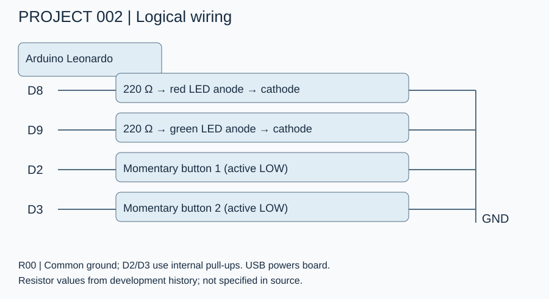
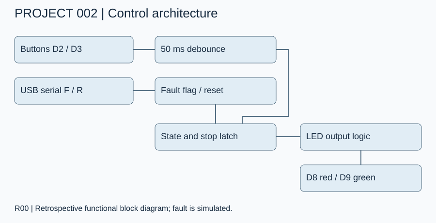
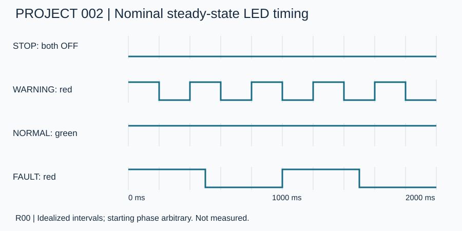

# Project 002 — Dual-Button Control System

**Criterion Works | Engineering Portfolio**

| Field | Value |
|---|---|
| Project ID | 002 |
| Platform | Arduino Leonardo |
| Development status | Completed (developer-reported) |
| Documentation revision | R00 |
| Verification | Static source review; hardware retest pending |

## Overview
A two-button, two-LED embedded controller implementing debounced inputs, operating states, non-blocking warning signals, and serial-command fault simulation. The fault is simulated in software, not detected by a physical sensor.

## Hardware and wiring
| Signal | Pin | Connection |
|---|---|---|
| Red LED | D8 | LED and series current-limiting resistor to GND |
| Green LED | D9 | LED and series current-limiting resistor to GND |
| Button 1 | D2 | Momentary switch to GND, INPUT_PULLUP |
| Button 2 | D3 | Momentary switch to GND, INPUT_PULLUP |

Arduino Leonardo, USB cable, breadboard, two LEDs, two current-limiting resistors and two buttons. Original development records identify 220 Ω resistors; the source code does not establish resistance values.

## Architecture

## Operating states
| State | Trigger | Red LED | Green LED |
|---|---|---|---|
| STOP | Startup, both debounced buttons held (unless fault active), or fault reset | Off | Off |
| WARNING | New button 1 press | Toggle every 200 ms | Off |
| NORMAL | New button 2 press | Off | Steady on |
| FAULT | Uppercase F over serial | Toggle every 500 ms | Off |

Both buttons must be released before another button press can restart operation after a latched stop. Uppercase R clears an active simulated fault and returns the controller to STOP. Fault overrides button commands. Inputs use a nominal 50 ms debounce interval. Serial initialization is 9600 baud.

## Source code
[Final retained sketch](src/Project002_Challenge6_FaultDetection/Project002_Challenge6_FaultDetection.ino)

### Development history
- [Project002_Challenge1](development/Project002_Challenge1/Project002_Challenge1.ino) — External LED blink, 500 ms intervals.
- [Project002_Challenge2_Button](development/Project002_Challenge2_Button/Project002_Challenge2_Button.ino) — Active-low button follows input.
- [Project003_Challenge3_Toggle](development/Project003_Challenge3_Toggle/Project003_Challenge3_Toggle.ino) — Debounced toggle with serial status.
- [Project002_Challenge4_ControlPanel](development/Project002_Challenge4_ControlPanel/Project002_Challenge4_ControlPanel.ino) — Dual-button state control and stop latch.
- [Project002_Challenge4_LED_Tested](development/Project002_Challenge4_LED_Tested/Project002_Challenge4_LED_Tested.ino) — Independent two-LED output test.
- [Project002_Challenge5_AutomaticSignals](development/Project002_Challenge5_AutomaticSignals/Project002_Challenge5_AutomaticSignals.ino) — Automatic warning and normal signals.

The toggle sketch retains its original `Project003` filename; its content corresponds to the Project 002 toggle exercise. Challenge 6 is selected as the final retained implementation.

## Operation
Open the final sketch in Arduino IDE, select Arduino Leonardo and its port, connect the circuit as shown, and upload. Use the two buttons to select WARNING or NORMAL. Hold both buttons until debounced to stop. Open Serial Monitor and send uppercase F to simulate a fault; send uppercase R to reset to STOP.

## Verification and limitations
- [Functional test record](docs/002_TST_001_functional-test-record_R00.md)
- [Static source review and integrity hashes](docs/002_RPT_001_source-code-review_R00.md)

Development records report successful button toggle, latched stop, automatic signaling, simulated fault override and reset. No independent compilation, hardware retest, instrument timing measurement or original photographs are available for this documentation review. Timing diagrams depict nominal steady-state behavior, not measured waveforms. Blink phase is not reset on mode transitions. This is a learning prototype, not a safety-rated controller or emergency stop.

## Skills practiced
Digital I/O, active-low inputs, debouncing, edge detection, state management, non-blocking timing, serial commands, fault-priority logic and incremental troubleshooting.

## Lessons and future work
Separate input conditioning from state logic and output behavior. Future improvements may include deterministic blink phase on state entry, physical fault sensing, invalid-command feedback and repeatable hardware tests.

## Revision history
| Revision | Description |
|---|---|
| R00 | Retrospective documentation and original source review |
